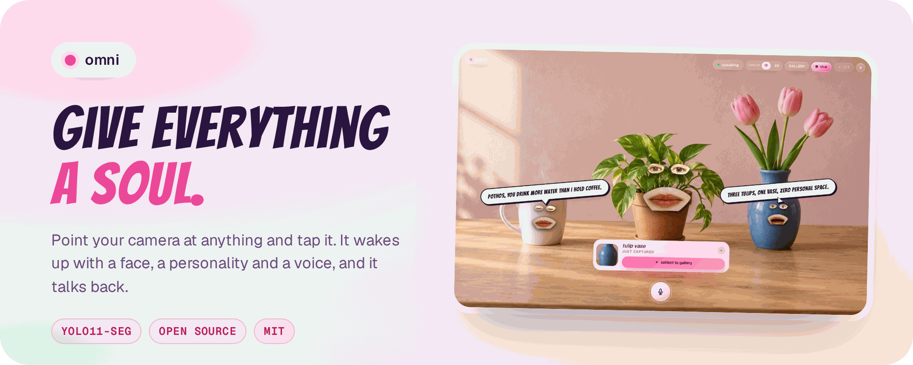
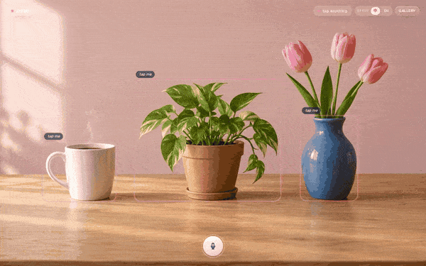
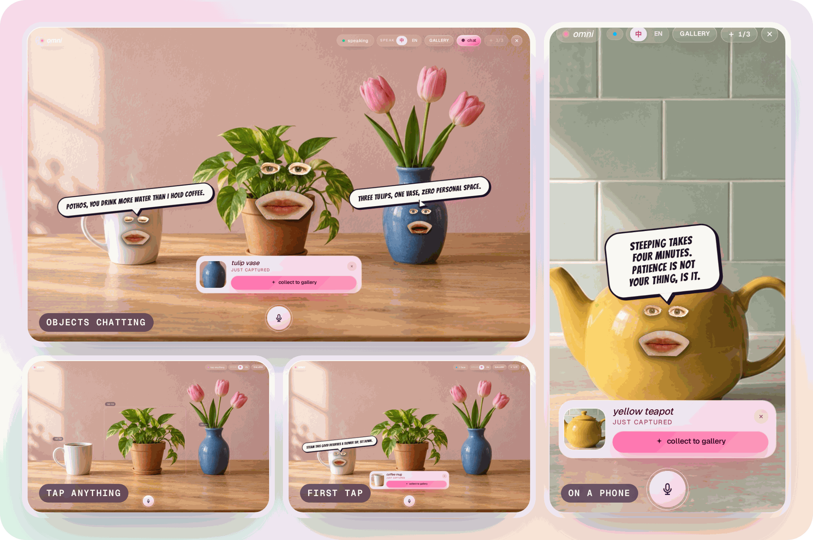
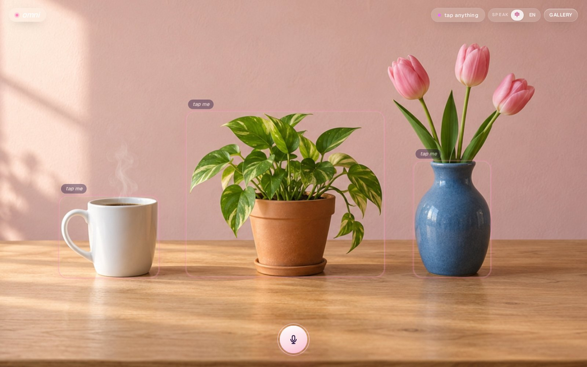
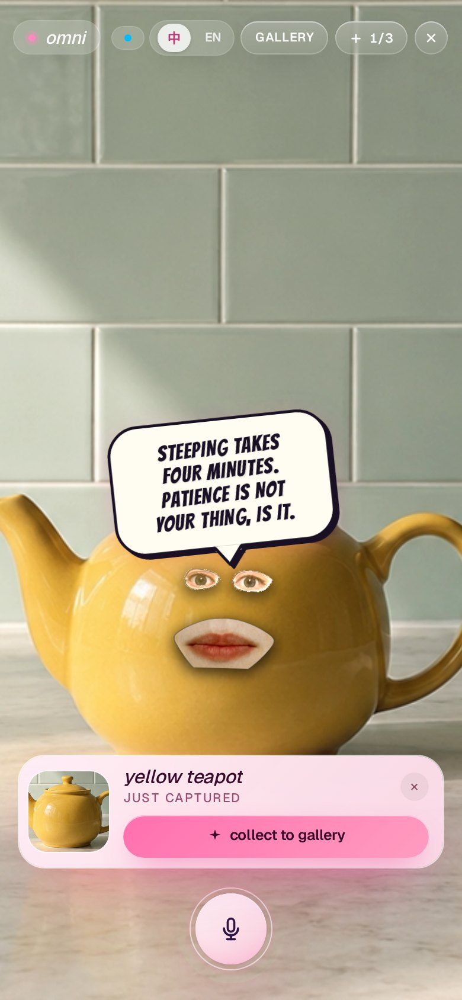
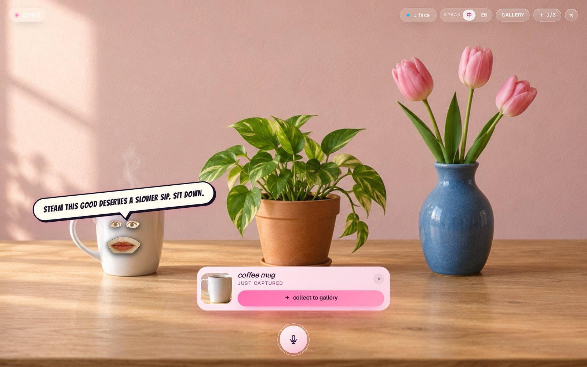
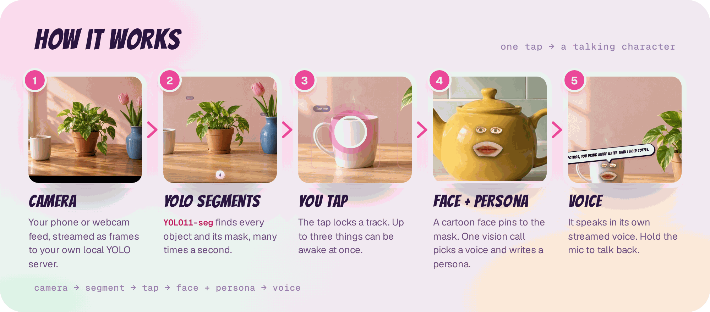

<p align="center">
  
</p>

<p align="center">
  <a href="#-quick-start"><b>Quick start</b></a> ·
  <a href="#-what-it-does"><b>What it does</b></a> ·
  <a href="#-how-it-works"><b>How it works</b></a> ·
  <a href="#-configuration"><b>Config</b></a> ·
  <a href="https://harrythentrepreneur.github.io/omni/"><b>Website</b></a>
</p>

<p align="center">
  <a href="LICENSE"></a>
  
  
  
  
  <a href="#-contributing"></a>
</p>

# Omni 🌸

> *Everything has a voice. Choose what it teaches you.*

Hey, you! 👋 Welcome to **Omni**, a joyful little open-source experiment that turns the world around you into a cast of chatty, cartoon-faced characters. Point your phone at a mug, a houseplant, a half-eaten sandwich or your very judgemental office chair, tap it, and *boom*: it wakes up with eyes, a mouth, a personality and a voice of its own. Then you can talk back. 🎙️✨

It's silly. It's warm. It's the kind of magic we wanted to exist, so we built it. We hope you love hacking on it as much as we loved making it.

<p align="center">
  
</p>

<sub>The screenshots and GIF are the real app, recorded headless with a still photo as the camera and a local stand-in for the AI keys, so the lines you see are scripted.</sub>

---

## ✨ What it does

<p align="center">
  
</p>

Omni is really **two tiny apps** sharing one cozy codebase.

### 🎯 Tracker *(the main one, at `/`)*

Your camera becomes a world full of characters.

- **Live object segmentation.** Camera frames stream over a WebSocket to a small local Python server running Ultralytics **YOLO11-seg**, which sends back every object and its mask many times a second. 🧠
- **Tap to bring things to life.** A cartoon face (`FaceVoice`) latches onto the object and follows it around, pinned with mask-centroid anchors even as the object moves, shrinks or hides behind things. 🪄
- **A unique persona per object.** One vision call (GLM `glm-5v-turbo`, with OpenAI `gpt-4o-mini` as fallback) names the thing, picks a voice from the catalogue, writes the opening line and captures a persona card. Every retap and every reply after that runs text-only off the card (Cerebras Llama when you have a key), so the character stays *consistent* and answers fast.
- **Talk back!** Hold the mic, say something, and your cup, lamp or dog toy answers in character, in its own streamed voice. Speech recognition runs in the browser (Web Speech, with on-device Whisper as a fallback).
- **Up to 3 objects awake at once.** They even talk to each other. 🗣️🗣️🗣️
- **Collect them.** Every new character pops up in a little capture card. Keep it in the `/gallery`, where it can get a comic-book portrait.

<table>
  <tr>
    <td width="62%"></td>
    <td width="38%" rowspan="2"></td>
  </tr>
  <tr>
    <td></td>
  </tr>
</table>

### 🪞 Mirror *(at `/mirror`)*

The original experiment. Your webcam streams to the local Python server, which uses dlib + OpenCV `seamlessClone` to paste your real eyes and mouth onto a base image (an orange, a pumpkin, whatever you upload). You become the thing. It's weird and wonderful. 🍊👀

---

## 🧭 How it works

<p align="center">
  
</p>

1. **Camera.** The browser grabs frames from your phone or webcam and sends them to `/ws/yolo`. Next.js proxies that to the Python server, so a phone only ever talks to one origin.
2. **Segment.** `server/yolo_ws.py` runs YOLO11-seg and returns boxes, masks and mask centroids. Between inferences the face glides at 60 fps on per-track velocity, so it doesn't stutter.
3. **Tap.** The smallest detection under your finger wins (the cup, not the table). That locks a track.
4. **Face + persona.** A cartoon face is anchored to the mask, and one bundled vision call returns the name, voice, persona card and first line.
5. **Voice.** `/api/speak` streams the line through Cartesia TTS straight into a per-track Web Audio graph. The analyser drives the mouth shapes, so the lips move with the voice.

Deeper architecture notes, prompt design and the load-bearing constants live in [`CLAUDE.md`](./CLAUDE.md). Read it before you touch the tracking loop.

---

## 🚀 Quick start

Requires **Node ≥ 20**, **pnpm** (we ❤️ pnpm) and **Python 3.12** for the vision server.

```bash
pnpm install                      # also copies the ONNX runtime WASM into public/ort
cp .env.example .env.local        # then add your keys (see below)
```

Start the YOLO server (one-time setup first):

```bash
python3 -m venv server/.venv
server/.venv/bin/pip install ultralytics opencv-python dlib imutils numpy openai \
  fastapi "uvicorn[standard]" python-multipart websockets python-dotenv
pnpm server                       # FastAPI + WebSocket on :8000, serves /ws/yolo
```

Then the app:

```bash
npx next dev                      # http://localhost:3000 (camera works on localhost)
```

Open `/`, allow the camera, and start tapping things. 🎉

**On a phone?** Browsers only give camera access over HTTPS. `pnpm dev` serves HTTPS on `0.0.0.0:3000` with a cert at `certificates/key.pem` and `certificates/cert.pem` (make one with [mkcert](https://github.com/FiloSottile/mkcert)). `pnpm demo` runs the app and the Python server together. Mirror also needs dlib's 68-landmark model in `server/` (see `CLAUDE.md`).

The first run downloads `yolo11s-seg.pt` if it isn't in the repo root. Set `YOLO_MODEL=yolo11m-seg.pt` for cleaner masks at a little more latency.

---

## 🔧 Configuration

Everything lives in `.env.local` at the repo root. [`.env.example`](./.env.example) has the full list with comments.

| Variable | Needed? | What it does |
|---|---|---|
| `ZHIPU_API_KEY` | **yes** | GLM `glm-5v-turbo`: first-tap vision call, face placement, object notes |
| `OPENAI_API_KEY` | **yes** | `gpt-4o-mini` fallback for the first tap, plus server speech-to-text fallback |
| `CARTESIA_API_KEY` | recommended | The voices. Without it Omni runs caption-only |
| `CEREBRAS_API_KEY` | recommended | Fast text-only replies on the hot path (retaps and conversation) |
| `RUNWARE_API_KEY` | optional | Comic-book portraits in `/gallery` |
| `YOLO_MODEL`, `YOLO_IMGSZ` | optional | Vision server model file and input size (defaults `yolo11s-seg.pt`, `704`) |
| `PYTHON_BACKEND_URL` | optional | Where Next proxies `/ws/yolo` (default `http://127.0.0.1:8000`) |
| `NEXT_PUBLIC_ASSET_BASE_URL` | optional | CDN folder for the `/landing` videos. Unset means the copies in `public/landing` |

### Scripts

| Command | What it does |
|---|---|
| `pnpm dev` | Next.js with HTTPS on `0.0.0.0:3000` (needs `certificates/`) |
| `pnpm server` | The Python server: YOLO WebSocket + Mirror |
| `pnpm demo` | App and Python server together |
| `pnpm build` / `pnpm start` | Production build and serve |
| `pnpm typecheck` | `tsc --noEmit`, the only automated gate |

No lint script, no test framework. Just vibes and types. 💅

---

## 📂 Where things live

```
app/                      Next.js routes (/, /mirror, /gallery, /landing)
  actions.ts              Server actions: assess / describe / generateLine / converseWithObject
  api/speak/              Bundled first-tap line + TTS in one streamed response
  api/tts/stream/         Streaming TTS passthrough
components/
  tracker.tsx             The Tracker UI + tracking loop (the big one)
  face-voice.tsx          The cartoon-face renderer (eyes video + mouth shapes)
  mirror.tsx              The Mirror UI
lib/
  yolo-ws.ts              WebSocket client for the YOLO server
  iou.ts                  IoU matching, EMA smoothing, anchor math
  tts.ts                  Cartesia streaming TTS
  whisper.ts              On-device speech recognition fallback
server/
  yolo_ws.py              YOLO11-seg over WebSocket
  server.py               FastAPI app: /ws/yolo + Mirror
public/facevoice/         Eyes video + mouth-shape PNGs
docs/                     The GitHub Pages site
```

---

## 🧁 The vibe

Pink. Pastel. Bubbly. Blob-floaty. Intentionally joyful.
If you see `animate-blob-float`, `soft-pulse`, `wiggle-on-hover` or a pastel radial background, that's the house style, not cruft. Keep it sparkly. ✨

---

## 🤝 Contributing

We'd absolutely love your help! A new voice in the catalogue, a bug fix in the tracking loop, a new base image for Mirror, or just a typo: **please open a PR**. There are no silly ideas here.

A few gentle guidelines:

- Keep the pink, pastel, bubbly look unless there's a reason not to. 🌸
- Prefer editing existing files over creating new ones.
- Run `pnpm typecheck` before pushing.
- If you touch the tracking loop, read the "Things to know" part of `CLAUDE.md` first. A few constants and guards look innocent but really aren't.

Stuck? Confused? Curious? **Open an issue** and say hi. We answer every one. 💌

---

## 💐 Credits

Omni stands on some lovely shoulders:

- [Ultralytics YOLO](https://github.com/ultralytics/ultralytics) for segmentation (AGPL-3.0, so check their terms before you ship it commercially)
- [onnxruntime-web](https://onnxruntime.ai/) and [Transformers.js](https://github.com/huggingface/transformers.js) for in-browser models
- [dlib](http://dlib.net/) and [OpenCV](https://opencv.org/) for Mirror, which grew out of the "Annoying Orange with My Face" seamless-clone demo (see `server/README.md`)
- [Zhipu GLM](https://open.bigmodel.cn/), [OpenAI](https://openai.com/), [Cerebras](https://www.cerebras.ai/), [Cartesia](https://cartesia.ai/) and [Runware](https://runware.ai/) for the brains and the voices
- [Geist](https://vercel.com/font) and [Bangers](https://fonts.google.com/specimen/Bangers) for the type
- [Next.js](https://nextjs.org/), [React](https://react.dev/) and [Tailwind CSS](https://tailwindcss.com/)

## 📜 Licence

[MIT](./LICENSE) © 2026 Harry Edwards. Do whatever brings you joy. Third-party models and services keep their own licences and terms.

---

## 🌈 A note from us

Omni started as a hackathon toy and grew into something we genuinely adore. The world is full of objects we walk past without noticing. Giving them a voice, even a silly one, changes how you see a room. We hope it does the same for you.

Go tap something. See what it has to say. ✨

Made with 🫧 and too much espresso.
